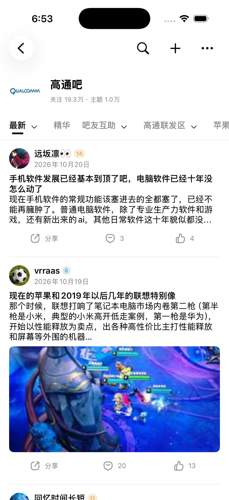
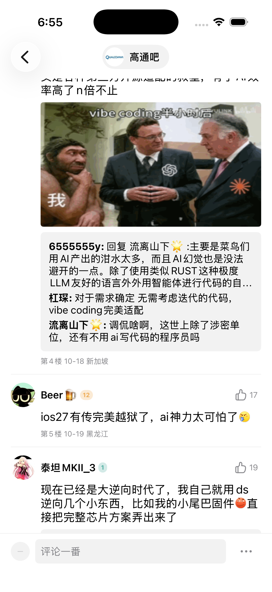
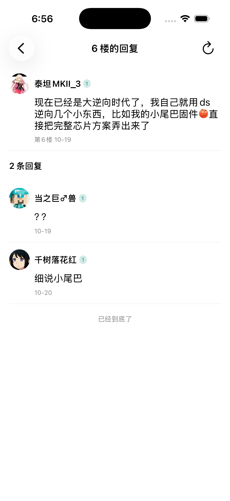
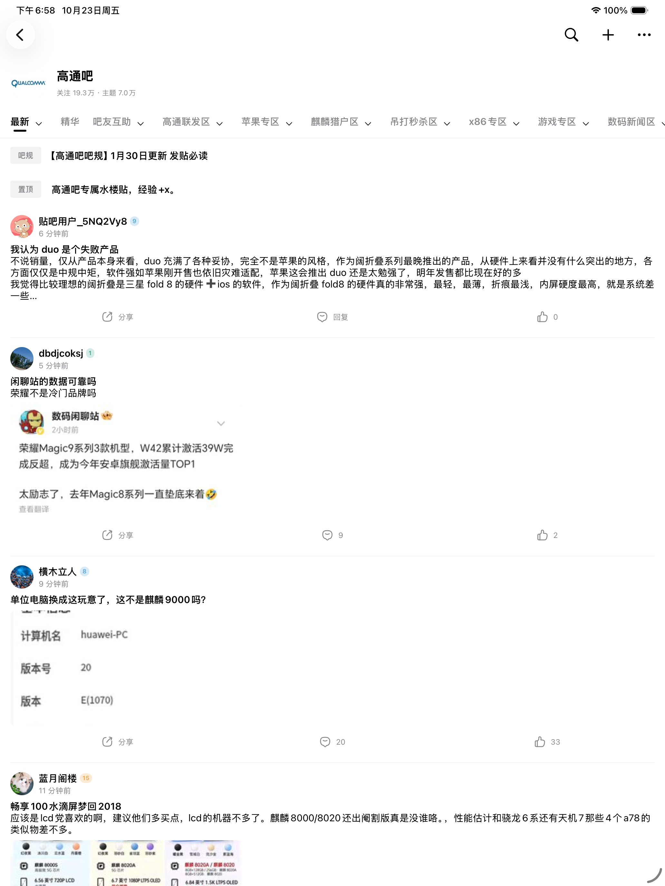

# TiebaLite iOS

一个原生 iOS / iPadOS 非官方贴吧客户端，面向日常看帖、楼中楼讨论、搜索与收藏，延续 TiebaLite 的简洁界面。

**当前版本：[v0.2.0beta7](https://github.com/othbradar/tiebalite-ios/releases/tag/v0.2.0beta7)** · App **0.2.1 / Build 20** · iOS / iPadOS **18.0+**

[下载 IPA](https://github.com/othbradar/tiebalite-ios/releases/tag/v0.2.0beta7) · [SideStore 订阅源](https://raw.githubusercontent.com/othbradar/tiebalite-ios/main/sidestore/source.json) · [更新说明](Docs/Releases/v0.2.0beta7.md) · [反馈问题](https://github.com/othbradar/tiebalite-ios/issues)

## 当前界面

以下是 2026-10-23 使用 **0.2.1 / Build 20 正常 Live App** 拍摄的模拟器截图，展示公开内容；不是旧版截图或 Fixture 页面。点击图片查看原图。[设备与采集说明](Docs/Screenshots/v0.2.0beta7/README.md)

| iPhone · 吧首页 | iPhone · 带图回复与楼中楼预览 | iPhone · 独立楼中楼 |
| --- | --- | --- |
| <a href="Docs/Screenshots/v0.2.0beta7/iphone-forum.png"></a> | <a href="Docs/Screenshots/v0.2.0beta7/iphone-thread.png"></a> | <a href="Docs/Screenshots/v0.2.0beta7/iphone-subposts.png"></a> |

**iPad · 吧首页**

<a href="Docs/Screenshots/v0.2.0beta7/ipad-forum.png"></a>

## 功能

| 场景 | 已实现能力 |
| --- | --- |
| 浏览与搜索 | 最近浏览和关注的吧；动态推荐、关注与热榜；吧首页分类、排序与分页。全局搜吧、搜帖、搜人；搜帖可选新帖在前、旧帖在前、相关度。吧内搜索支持只看主题 / 只看评论、新帖 / 相关排序与搜索历史。 |
| 帖子与讨论 | 楼层分页、热门 / 正序 / 倒序、全部回复 / 只看楼主；这两组选择全局记忆。主帖最多预览 3 条子回复，点预览进入独立楼中楼，再点具体子回复正文打开回复编辑器；普通楼层正文也可直接回复。保留复制、图片及链接独立操作。 |
| 账号与内容操作 | 可见网页登录、会话恢复；用户主题、关注的吧、关注与粉丝列表。回复我的 / 提到我的及未读计数；发帖、回复、图片与表情选择、按账号和回复目标保存草稿；点赞 / 取消、确认删除本人内容。 |
| 收藏与媒体 | 云端收藏及同步、本机帖子 / 楼层书签；图片缩放、切图、原图保存与系统分享；帖内原位视频，可选自动或点击播放；语音、GIF / WebP 动画，离屏或后台停止。 |
| 阅读与适配 | 内容及图片缓存、有限预载、阅读位置恢复；站内链接原生打开、外链使用系统浏览器；淡蓝应用图标、深色模式、阅读字号、Reduce Motion、iPhone / iPad 横竖屏适配。 |

功能表描述当前实现，不代表每个设备、账号或服务端场景全部验收。历史功能验证见 [U15 验收](Docs/Audits/U15_DAILY_USE_ACCEPTANCE.md)，后续修复见 [任务记录](Docs/Progress/TASK_STATE.md)。

## 安装与更新

### SideStore

在 SideStore 的 **Sources** 中添加：

```text
https://raw.githubusercontent.com/othbradar/tiebalite-ios/main/sidestore/source.json
```

已添加源的用户刷新 Sources，再到 **My Apps** 检查 **Update**。签名刷新与安装新版是两个操作；手动导入的旧 App 能否与源关联，取决于 SideStore 的安装记录。源直接使用 GitHub Release 的 IPA，版本、大小和 SHA256 从附件提取并校验。[详细说明](sidestore/README.md)

发布元数据与源更新的验证范围见 [发布记录](Docs/Audits/RELEASE_0_2_0_BETA_7.md)，不将其表述为已经完成所有 SideStore 真机更新提示、签名和覆盖安装流程的验收。

### 手动安装

从 [Release](https://github.com/othbradar/tiebalite-ios/releases/tag/v0.2.0beta7) 下载完整 ARM64 **未签名 IPA**，使用自己的签名工具安装。沿用原 Apple ID / Team 和签名后的 Bundle ID 覆盖安装，保留账号、草稿及数据；不要先卸载旧版。附件同时提供 `SHA256SUMS`。

## 缓存与权限

- 内容缓存按账号和查询条件隔离；重入可恢复已缓存的内容与阅读位置。过期、权限失效或尚未缓存的页面仍需联网。
- 内容预载最多两个后台候选，前台请求优先；关闭预载、低电量、低数据模式或进入后台时停止投机预载。
- 内容 / 图片缓存预算分别为 128 MiB / 512 MiB，使用可回收的 Caches 目录。草稿、书签和设置独立保存；清图片缓存不会退出账号。
- 图片保存导出取得的原编码文件；原图不可用时明确失败。仅请求相册添加权限；上传图片使用系统选择器。

## 系统与工具要求

- macOS 26；
- Xcode 26.6（Swift 6.3.3 工具链，工程使用 Swift 6 language mode）；
- iOS/iPadOS 18.0 或更高；
- XcodeGen 2.45.4、SwiftLint 0.65.0、xcbeautify 3.2.1；
- `protoc` / `protoc-gen-swift` 35.1 / 1.38.1；
- Java 与 Javac 21.0.10（仅用于确定性生成合成 Proto fixture）。

`Config/ToolVersions.env` 是版本真相来源。`Brewfile` 安装 Homebrew 管理的工具，
Java 21.0.10 需由开发者单独安装并确保 `java`、`javac` 位于 `PATH`。

## 从干净 checkout 构建

```bash
git submodule update --init --recursive
cp scripts/project.env.example scripts/project.env
make bootstrap-tools
make doctor
make generate
make build
```

`scripts/project.env` 被 Git 忽略；默认模板不包含秘密，Simulator UDID 留空时会
自动选择可用设备。构建和测试不需要真实账号、Cookie、Keychain 数据或私有响应。
生成的 `TiebaLite.xcodeproj`、DerivedData 与测试结果也不会进入 Git。

要验证 Release：

```bash
make release-build
make release-isolation
```

`project.yml`、`Config/*.xcconfig`、`Config/SwiftPM/Package.resolved` 和测试计划
是工程声明的真相来源，不应手工提交生成的 `.xcodeproj`。

## Live 与 Fixture 边界

Production composition 固定使用 Live Repository、URLSession、Keychain 和
`ProductionImageLoader`，不会静默降级到 Fixture。Debug/UITesting 构建保留
固定 Fixture 与 Mock transport，用于离线演示、确定性测试和接口失效排查；
纯 Fixture Repository、LaunchScenario、Probe、Renderer/Pager/Media Lab 和
1000 条实验入口均从 Release 源与资源中排除。

贴吧接口为私有协议，可能随服务端变化。自动化测试不访问实时贴吧服务器；Live
证据只记录状态码、MIME、响应大小、解码结果、映射数量和 typed error，不保存
完整请求/响应或真实用户内容。

## 登录与隐私边界

- 用户只在可见 WKWebView 中手工输入账号、密码和验证码；App 不读取或保存明文
  密码。
- 运行所需的 BDUSS/STOKEN 仅保存于本 App 的 Keychain；不会写入日志、fixture、
  文档或 Git。
- 浏览历史保存在 App 沙盒内的本地 JSON，设置保存在 UserDefaults。
- 需要授权的 API 仅在有效会话 lease 下发送；图片 CDN 请求使用独立匿名会话，
  不携带登录 Cookie。
- 项目没有第三方分析 SDK；诊断日志只记录脱敏的类型和计数。

## 测试

```bash
make test-unit
make quality-fast
make release-isolation
make quality
```

测试安装通过 Xcode 覆盖现有 App，不卸载、不 erase、不清 Keychain；Fixture 使用隔离的内存会话、历史和设置。

`make quality` 是当前完整 RC 门禁，包含 Debug/Release 构建、Unit、iPhone/iPad
UI smoke、Pager/Media interaction、静态策略、秘密扫描和 Release 隔离。

## 已知限制

- 贴吧私有接口可能变化；服务端审核、风控与错误码不保证全部覆盖。自动化不发送真实内容，Live 发帖 / 回复由用户自行点击；私有 SDK / Passport 完整接入仍未完成。
- 参与投票、签到、私信、系统推送和批量离线下载尚未实现。
- 内容缓存占用 / 手动清理入口尚未接入；现有设置可清理图片缓存。缓存不是永久离线副本。
- 本地表情目录包含 132 张；服务端仅给出的 `[图片]` 文本无法恢复原图，未知表情保留原文。动图超预算时降级为静态帧；完整媒体编码、真实语音样本与全尺寸图片瓦片未覆盖。
- 部分模拟器采样仍有短时尖峰，不保证所有场景绝无卡顿。完整 VoiceOver、iOS 18.x runtime 和 Stage Manager 设备矩阵尚未验收。
- 当前全仓静态策略仍有记录在案的旧失败，本轮无新增；不能将定向回归、构建及用户验收合称为一次全绿的 `make quality`。

## 许可与来源

原创 iOS 源码采用 [GNU General Public License v3.0 only](LICENSE)。本项目为非官方客户端，未获得百度官方认可。

Android 参考、生成 Proto、图片和其他第三方材料继续适用各自的许可证及来源边界，见 [THIRD_PARTY_NOTICES.md](THIRD_PARTY_NOTICES.md) 和 [来源审计](Docs/Audits/SOURCE_AND_LICENSE_NOTES.md)。App Store / 商业二进制分发权利尚未完成独立确认。头像的已批准 HTTP 例外见 ADR-0024，图片请求不携带登录 Cookie。

根许可证不追溯改写 `v0.1.0-beta.1`、`v0.1.0-beta.2` 的历史许可快照。
